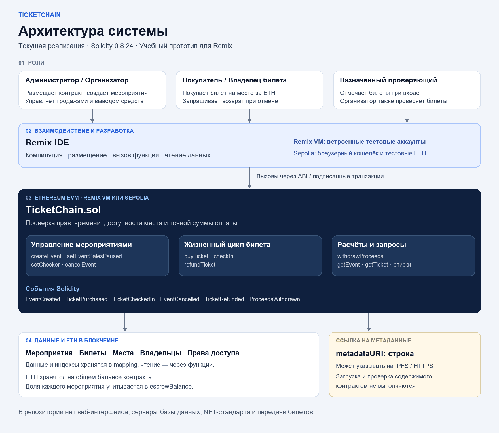

# TicketChain

**Учебный проект для продажи и проверки билетов на мероприятия в блокчейне Ethereum.**

TicketChain управляет созданием мероприятий, покупкой билетов на конкретные места, однократной проверкой билетов на входе и возвратом оплаты при отмене мероприятия. Владелец билета, номер места, уплаченная сумма и состояние билета сохраняются в блокчейне.

Текущая версия — **прототип смарт-контракта для работы через Remix IDE**. Отдельного веб-интерфейса, серверной части и базы данных в репозитории нет. Билеты не выпускаются как NFT стандарта ERC-721/ERC-1155; функция передачи билета другому владельцу отсутствует.

> Контракт создан для обучения и не проходил аудит безопасности. Для демонстрации используйте Remix VM или тестовые ETH в сети Sepolia.

## Содержание

- [Архитектура](#архитектура)
- [Возможности и роли](#возможности-и-роли)
- [Технологии](#технологии)
- [Структура проекта](#структура-проекта)
- [Что нужно для запуска](#что-нужно-для-запуска)
- [Запуск через Remix](#запуск-через-remix)
- [Сценарий демонстрации](#сценарий-демонстрации)
- [API контракта](#api-контракта)
- [Тесты и известные ограничения](#тесты-и-известные-ограничения)
- [Дальнейшее развитие](#дальнейшее-развитие)
- [Описание и теги для GitHub](docs/GITHUB_SETUP.md)

## Архитектура



[Редактируемая версия схемы в формате SVG](docs/images/architecture.svg)

1. **Пользователи.** Администратор создаёт мероприятие, покупатель приобретает билет, организатор или назначенный проверяющий отмечает билет при входе. Администратором становится аккаунт, разместивший контракт. Поскольку создавать мероприятия может только администратор, в текущей версии он также является организатором всех мероприятий.
2. **Уровень взаимодействия.** Remix IDE компилирует контракт и позволяет вызывать его функции. В Remix VM используются встроенные тестовые аккаунты. В Sepolia транзакции подписываются браузерным кошельком.
3. **Бизнес-логика.** `contracts/TicketChain.sol` проверяет права доступа, временные ограничения, доступность места и сумму оплаты. Успешные операции сопровождаются событиями Solidity.
4. **Данные и средства.** Мероприятия, билеты, занятые места, билеты пользователей и разрешения проверяющих хранятся в структурах `mapping`. ETH находятся на балансе контракта; доля каждого мероприятия учитывается отдельно в `escrowBalance`.
5. **Метаданные.** `metadataURI` — строка со ссылкой на описание. Код не загружает файлы в IPFS, не открывает ссылку и не проверяет содержимое. При необходимости хранилище IPFS/HTTPS подготавливается отдельно.

Основной сценарий: **создание мероприятия → покупка билета → check-in → вывод выручки после завершения мероприятия**. Альтернативный сценарий: **отмена мероприятия → самостоятельный запрос возврата владельцем билета**.

## Возможности и роли

| Роль | Действия |
| --- | --- |
| Администратор / организатор | Создание мероприятий, приостановка и возобновление продаж, назначение проверяющих, check-in, отмена мероприятия, вывод выручки |
| Покупатель | Покупка билета на свободное место, просмотр своих билетов, возврат оплаты при отмене мероприятия |
| Проверяющий | Отметка билета как использованного через check-in для мероприятий, к которым предоставлен доступ |
| Любой аккаунт | Получение информации о мероприятиях и билетах через открытые функции чтения |

Правила контракта:

- Вместимость мероприятия — **1–200 мест**, нумерация мест начинается **с 1**.
- Цена билета должна быть больше нуля. `msg.value` должен точно совпадать с ценой.
- Одно место нельзя продать повторно. Продажи закрываются с началом мероприятия.
- Check-in открывается **за 1 час до начала** и доступен до `endsAt` включительно. Повторно использовать билет нельзя.
- Отменить мероприятие можно только до открытия окна check-in.
- Возврат доступен владельцу неиспользованного билета отменённого мероприятия, если оплата ещё не возвращалась. Расходы на газ не возмещаются.
- Организатор может однократно вывести выручку начиная с `endsAt`, если мероприятие не отменено.
- Прямой перевод ETH на адрес контракта без вызова функции отклоняется: для покупки используется `buyTicket`.
- Для постраничного чтения списков `limit` должен быть в диапазоне **1–100**; `offset` начинается **с 0**.

## Технологии

| Технология | Назначение |
| --- | --- |
| Solidity **0.8.24** | Основной смарт-контракт без внешних Solidity-библиотек |
| Ethereum / EVM | Выполнение контракта, хранение состояния и баланса ETH |
| Remix IDE и Remix VM | Компиляция, локальная демонстрация и вызов функций |
| TypeScript и ethers.js **v5 API** | Скрипты размещения и тестирования из репозитория |
| Remix Solidity Unit Testing | Среда запуска Solidity-тестов |
| Sepolia и браузерный кошелёк | Дополнительная демонстрация в тестовой сети |

## Структура проекта

```text
ticketchain/
├── README.md                       # Описание проекта и запуск
├── README.txt                      # Исходная инструкция шаблона Remix
├── contracts/
│   ├── TicketChain.sol             # Основной контракт проекта
│   ├── 1_Storage.sol               # Учебный пример Remix
│   ├── 2_Owner.sol                 # Учебный пример Remix
│   └── 3_Ballot.sol                # Учебный пример Remix
├── scripts/
│   ├── deploy_ticketchain.ts       # Скрипт размещения TicketChain
│   ├── ethers-lib.ts              # Размещение через ABI и байткод
│   ├── run_ticketchain_tests.ts    # Тестовые сценарии TypeScript для Remix
│   └── deploy_with_ethers.ts       # Исходный пример для Storage
├── tests/
│   ├── TicketChain_test.sol       # Solidity-тесты TicketChain
│   ├── Ballot_test.sol            # Учебный пример Remix
│   └── storage.test.js            # Учебный пример Remix
├── artifacts/                     # ABI, байткод, метаданные и build-info
├── docs/
│   ├── GITHUB_SETUP.md            # Описание, теги и примеры Markdown
│   └── images/architecture.*      # Схема архитектуры в PNG и SVG
└── remix.config.json             # Конфигурация рабочего окружения Remix
```

## Что нужно для запуска

**Для Remix VM:** браузер, интернет и [Remix IDE](https://remix.ethereum.org). Установка кошелька, реальные ETH, Node.js, сервер и файл `.env` не требуются. В репозитории нет `package.json` и команды `npm start`.

**Дополнительно для Sepolia:** браузерный кошелёк, подключённый к Sepolia, и тестовые ETH для оплаты газа и покупки билетов. Не загружайте приватные ключи и seed-фразу в код или GitHub.

Подготовьте минимум два аккаунта: A — администратор/организатор, B — покупатель. Для демонстрации роли проверяющего можно добавить аккаунт C.

## Запуск через Remix

1. Скачайте [репозиторий](https://github.com/Mevinss/ticketchain) и импортируйте файлы в рабочее пространство Remix. Для простой демонстрации достаточно скопировать `contracts/TicketChain.sol` в новое рабочее пространство.
2. В разделе **Solidity Compiler** выберите версию **0.8.24** и скомпилируйте `TicketChain.sol`.
3. В разделе **Deploy & Run Transactions** выберите среду **Remix VM** и аккаунт A. Убедитесь, что в поле Contract выбран **TicketChain**.
4. Нажмите **Deploy**. Параметры конструктора не нужны. Функция `admin()` должна возвращать адрес A.
5. Откройте контракт в Deployed Contracts и выполните сценарий ниже.

Для Sepolia выберите вместо VM среду подключения к браузерному кошельку, проверьте сеть Sepolia в кошельке и подтвердите транзакцию размещения. Сохраните адрес контракта и хеш транзакции.

**Дополнительный скрипт размещения:** после импорта полного рабочего пространства и компиляции контракта можно выполнить `scripts/deploy_ticketchain.ts` через **Run** в Remix. Вспомогательный файл `ethers-lib.ts` ожидает `browser/artifacts/TicketChain.json` и ethers v5 API. Проверьте их доступность в вашей среде; размещение кнопкой Deploy этого скрипта не требует.

## Сценарий демонстрации

### 1. Создание мероприятия

От аккаунта A вызовите `createEvent`:

| Параметр | Пример / требование |
| --- | --- |
| `title` | `TicketChain Demo` |
| `metadataURI` | `ipfs://example` — заполнитель, а не реально опубликованный файл |
| `startsAt` | Unix timestamp в секундах: на 2 дня позже времени текущего блока |
| `endsAt` | `startsAt + 86400` |
| `ticketPrice` | `10000000000000000` wei = **0.01 ETH** |
| `capacity` | `10` |

ID первого мероприятия в новом контракте — `1`. Рассчитайте время перед демонстрацией: `startsAt` должен быть больше времени текущего блока, а `endsAt` — позже `startsAt`.

### 2. Покупка билета

Переключитесь на аккаунт B. В Remix установите **Value** в `0.01`, единицу измерения — **Ether**, и вызовите `buyTicket(1, 1)`. Проверьте первый билет нового контракта через `getTicket(1)`. В `getEvent(1)` должны отображаться `ticketsSold = 1` и `escrowBalance = 10000000000000000`.

Перед следующими вызовами функций без оплаты верните **Value = 0**.

### 3. Возврат оплаты

В предыдущем примере мероприятие начинается через 2 дня, поэтому аккаунт A может вызвать `cancelEvent(1)`. Затем от аккаунта B выполните `refundTicket(1)`. В `getTicket(1)` должно быть `refunded = true`, в `getEvent(1)` — `escrowBalance = 0`. Средства не рассылаются автоматически: каждый владелец билета запрашивает возврат самостоятельно.

### 4. Check-in и вывод выручки

Показывайте этот сценарий на **отдельном, неотменённом мероприятии**. Создайте его с началом через 30 минут и купите билет: окно check-in уже будет открыто. Аккаунт A может назначить проверяющего через `setChecker(eventId, C, true)`; A или C вызывает `checkIn(ticketId)`. Проверьте состояние `used = true`.

После наступления `endsAt` вызовите `withdrawProceeds(eventId)` от аккаунта A. До этого ожидается ошибка `WithdrawTooEarly`. Перемещать время можно только в локальной тестовой среде, которая это поддерживает; изменить время Sepolia вручную нельзя.

## API контракта

| Функция | Назначение / доступ |
| --- | --- |
| `createEvent(title, metadataURI, startsAt, endsAt, ticketPrice, capacity)` | Создание мероприятия; только администратор |
| `setEventSalesPaused(eventId, paused)` | Управление продажами; организатор |
| `setChecker(eventId, checker, allowed)` | Назначение и отзыв проверяющего; организатор |
| `buyTicket(eventId, seatNumber)` | Покупка с отправкой точной стоимости билета в ETH |
| `checkIn(ticketId)` | Отметка билета как использованного; организатор/проверяющий |
| `cancelEvent(eventId)` | Отмена до установленного срока; организатор |
| `refundTicket(ticketId)` | Возврат оплаты за билет отменённого мероприятия; владелец билета |
| `withdrawProceeds(eventId)` | Вывод выручки завершившегося мероприятия; организатор |
| `getEvent(eventId)`, `getTicket(ticketId)` | Чтение мероприятия или билета |
| `getEvents(offset, limit)` | Постраничное чтение мероприятий |
| `getUserTicketIds(owner, offset, limit)` | Список ID билетов указанного адреса |
| `getUserTicketCount(owner)` | Количество билетов указанного адреса |
| `getSeatTicketIds(eventId)` | ID билетов по местам; `0` — место свободно, индекс массива — `seatNumber - 1` |
| `isChecker(eventId, account)` | Проверка, является ли аккаунт организатором или назначенным проверяющим |

События: `EventCreated`, `SalesPausedChanged`, `CheckerUpdated`, `TicketPurchased`, `TicketCheckedIn`, `EventCancelled`, `TicketRefunded`, `ProceedsWithdrawn`.

Запросы чтения могут выполняться без транзакции. Вызовы, изменяющие состояние, требуют газа; стоимость билета оплачивается отдельно от газа.

## Тесты и известные ограничения

В репозитории есть тесты на Solidity и TypeScript для сценариев создания мероприятий, продаж, возвратов, проверки прав, времени и постраничного чтения. **Наличие тестов не означает, что все они успешно выполняются.**

- `tests/TicketChain_test.sol` предназначен для плагина Remix **Solidity Unit Testing**. В текущем файле глобальные типы `EventData`/`Ticket` используются как `TicketChain.EventData`/`TicketChain.Ticket`, функция `tests_accounts` не определена, а для низкоуровневого `call` применена недопустимая конструкция `try`. Сначала нужно исправить эти проблемы компиляции.
- Часть Solidity-тестов содержит только структурные проверки или пустое тело вместо перемещения времени и вызовов от разных аккаунтов. Их нужно дополнить для полноценной проверки поведения.
- `scripts/run_ticketchain_tests.ts` зависит от Remix: нужны ethers v5, `web3Provider`, `remix.call` и поддержка перемещения времени. Вспомогательная функция `assertEqual` преобразует значения в числа, но вызывается также для сравнения строк; текстовые проверки требуют исправления. Это не обычный скрипт для `node`/`npm test`.
- Перед размещением заново компилируйте текущий код, не полагаясь только на сохранённые файлы `artifacts/`.
- `checkIn` проверяет ID билета и права проверяющего. Подтверждение того, что посетитель действительно владеет билетом, и проверка подписи QR-кода в этой версии не реализованы.

Изменения документации не затрагивают контракт, скрипты размещения и логику тестов.

## Дальнейшее развитие

Следующие пункты — план работ, а не уже реализованные возможности:

- [ ] Исправить компиляцию Solidity-тестов и функцию сравнения в TypeScript.
- [ ] Добавить воспроизводимую тестовую среду с управлением аккаунтами и временем, настроить CI.
- [ ] Создать веб-интерфейс с подключением кошелька, выбором места и разделом «Мои билеты».
- [ ] Объединить QR-код и подпись кошелька для подтверждения владельца билета.
- [ ] Спроектировать роли для нескольких организаторов.
- [ ] Добавить публикацию метаданных, проверку целостности содержимого URI и индексацию событий.
- [ ] Провести независимый аудит безопасности перед использованием реальных средств.

## Лицензия

В `contracts/TicketChain.sol` указан `SPDX-License-Identifier: MIT`. Отдельного файла `LICENSE` в репозитории нет; для оформления условий лицензирования всего репозитория его должен добавить правообладатель.
